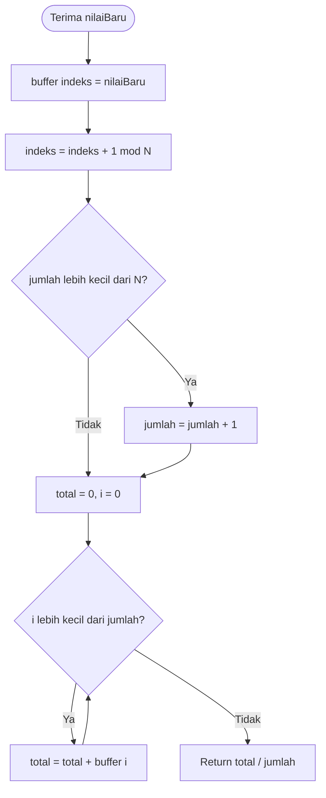

# Modul 5 - Percobaan - Pengolahan dan Analisis Data IoT (Filtering, Analisis dan Visualisasi)

# Penjelasan Program Praktikum

## A. Program `5a.ino` — Pengolahan Data Sensor pada ESP32 (Moving Average dan Statistik)

### Kode Program

```cpp
// Sensor DHT22 diganti dengan data dummy (mock) karena tidak ada sensor fisik

// Mock function pengganti sensor DHT22
float bacaSuhuMock() {
    static unsigned long jumlahBaca = 0;
    jumlahBaca++;

    // Suhu dasar berubah secara bertahap
    float suhuDasar = 28.0 + 2.0 * sin(jumlahBaca * 0.08);

    // Noise kecil untuk mensimulasikan fluktuasi sensor
    float noise = random(-5, 6) * 0.1;

    float suhu = suhuDasar + noise;

    // Lonjakan suhu setiap 25 pembacaan untuk simulasi anomali
    if (jumlahBaca % 25 == 0) {
        suhu += 8.0;
    }

    return suhu;
}

const int N = 5;                // jumlah sampel moving average
float buffer[N];                // menyimpan N pembacaan terakhir
int indeks = 0;                 // posisi penulisan berikutnya pada buffer
int jumlah = 0;                 // jumlah sampel yang sudah terisi

float suhuMin = 1000.0;
float suhuMax = -1000.0;

float hitungMovingAverage(float nilaiBaru) {
  buffer[indeks] = nilaiBaru;
  indeks = (indeks + 1) % N;
  if (jumlah < N) jumlah++;

  float total = 0;
  for (int i = 0; i < jumlah; i++) {
    total += buffer[i];
  }
  return total / jumlah;
}

void setup() {
  Serial.begin(115200);
  randomSeed(micros());  // seed acak untuk noise dummy
}

void loop() {
  float suhu = bacaSuhuMock();  // pembacaan sensor diganti mock

  if (isnan(suhu)) {
    Serial.println("Pembacaan gagal, data diabaikan");
  } else {
    float suhuFilter = hitungMovingAverage(suhu);
    if (suhu < suhuMin) suhuMin = suhu;
    if (suhu > suhuMax) suhuMax = suhu;

    Serial.print("Mentah: ");
    Serial.print(suhu);
    Serial.print(" | Filter: ");
    Serial.print(suhuFilter);
    Serial.print(" | Min: ");
    Serial.print(suhuMin);
    Serial.print(" | Max: ");
    Serial.println(suhuMax);
  }

  delay(2000);
}
```

### Penjelasan Kode

| Bagian Kode | Penjelasan |
|---|---|
| `bacaSuhuMock()` | Fungsi pengganti sensor DHT22 fisik: menghasilkan data dummy berupa gelombang sinus + noise acak + lonjakan anomali setiap 25 bacaan. |
| `jumlahBaca` (`static`) | Penghitung jumlah pembacaan; `static` agar nilainya dipertahankan antar pemanggilan fungsi. |
| `suhuDasar = 28.0 + 2.0 * sin(...)` | Suhu dasar berubah bertahap (gelombang sinus 26–30°C) untuk mensimulasikan perubahan suhu ruangan. |
| `random(-5, 6) * 0.1` | Noise acak −0.5 sampai +0.5°C untuk mensimulasikan fluktuasi/derau sensor. |
| `if (jumlahBaca % 25 == 0) suhu += 8.0` | Menyuntikkan lonjakan +8°C setiap 25 bacaan sebagai anomali buatan untuk pengujian filter dan z-score. |
| `N = 5` | Jumlah sampel jendela *moving average*. |
| `buffer[N]` | Array (circular buffer) yang menyimpan 5 pembacaan terakhir. |
| `indeks` | Posisi penulisan berikutnya pada buffer (berputar 0–4). |
| `jumlah` | Jumlah sampel valid yang sudah terisi (maksimal N, untuk fase awal saat buffer belum penuh). |
| `suhuMin = 1000.0` / `suhuMax = -1000.0` | Nilai awal ekstrem agar pembacaan pertama langsung memperbaruinya. |
| `hitungMovingAverage(nilaiBaru)` | Menyimpan nilai baru ke buffer, memajukan indeks melingkar, lalu merata-ratakan seluruh isi buffer. |
| `(indeks + 1) % N` | Operasi modulo agar indeks kembali ke 0 setelah mencapai N (circular buffer). |
| `randomSeed(micros())` | Inisialisasi pembangkit acak dari waktu mikro agar noise berbeda tiap reset. |
| `isnan(suhu)` | Validasi: jika bacaan tidak valid (NaN), data diabaikan dan tidak masuk filter/min/max. |
| `suhuFilter = hitungMovingAverage(suhu)` | Menghitung rata-rata 5 data terakhir untuk menghaluskan fluktuasi. |
| `if (suhu < suhuMin)` / `if (suhu > suhuMax)` | Memperbarui nilai minimum dan maksimum sejak program berjalan. |
| `Serial.print("Mentah: ... Filter: ... Min: ... Max: ...")` | Menampilkan data mentah, hasil filter, min, dan max ke Serial Monitor setiap 2 detik. |
| `delay(2000)` | Jeda 2 detik antar pembacaan mengikuti sampling rate sensor DHT22 (0.5 Hz). |

---

## B. Program `5b.py` — Akuisisi, Analisis, dan Visualisasi Data (Python + MQTT/CSV)

### Kode Program

```python
import time
import math
import random
import pandas as pd
import matplotlib.pyplot as plt

JUMLAH_SAMPEL = 30  # jumlah data

data = []

# -- Tahap 1: akuisisi data dummy (pengganti sensor DHT22 via MQTT)
# Mock function pengganti sensor DHT22 (sama seperti versi ESP)
jumlahBaca = 0  # penghitung jumlah pembacaan

def bacaSuhuMock():
    global jumlahBaca
    jumlahBaca += 1

    # Suhu dasar berubah secara bertahap
    suhuDasar = 28.0 + 2.0 * math.sin(jumlahBaca * 0.08)

    # Noise kecil untuk mensimulasikan fluktuasi sensor
    noise = random.randint(-5, 5) * 0.1  # random(-5,6) di C++ (maks eksklusif)

    suhu = suhuDasar + noise

    # Lonjakan suhu setiap 25 pembacaan untuk simulasi anomali
    if jumlahBaca % 25 == 0:
        suhu += 8.0

    return suhu

for i in range(JUMLAH_SAMPEL):
    suhu = bacaSuhuMock()
    data.append({"waktu": time.strftime("%Y-%m-%d %H:%M:%S"), "suhu": suhu})
    print(f"[{len(data)}/{JUMLAH_SAMPEL}] suhu = {suhu:.2f}")
    time.sleep(0.1)  # jeda kecil supaya kolom waktu bervariasi

# -- Tahap 2: simpan ke CSV
df = pd.DataFrame(data)
df.to_csv("data_suhu.csv", index=False)
print("Data tersimpan di data_suhu.csv")

# -- Tahap 3: analisis statistik dan deteksi anomali (z-score)
rata2 = df["suhu"].mean()
std = df["suhu"].std()

if std == 0:
    df["zscore"] = 0.0
else:
    df["zscore"] = (df["suhu"] - rata2) / std

df["anomali"] = df["zscore"].abs() > 2

print(f"Rata-rata   : {rata2:.2f}")
print(f"Std deviasi : {std:.2f}")
print(f"Minimum     : {df['suhu'].min():.2f}")
print(f"Maksimum    : {df['suhu'].max():.2f}")
print(f"Jumlah anomali: {df['anomali'].sum()}")

# -- Tahap 4: visualisasi
plt.figure(figsize=(10, 4))
plt.plot(df.index, df["suhu"], marker="o", label="Suhu")
anom = df[df["anomali"]]
plt.scatter(anom.index, anom["suhu"], color="red", s=100, label="Anomali", zorder=3)
plt.axhline(rata2, color="gray", linestyle="--", label="Rata-rata")
plt.xlabel("Urutan data")
plt.ylabel("Suhu (°C)")
plt.title("Data Suhu dan Deteksi Anomali")
plt.legend()
plt.tight_layout()
plt.savefig("grafik_suhu.png")
plt.show()
```

> Catatan: program modul asli memakai `paho-mqtt` (`on_connect`/`on_message` subscribe ke `TOPIC` ESP32). Versi di atas memakai fungsi mock yang identik agar dapat diuji tanpa broker/sensor fisik; logika Tahap 2–4 sama persis dengan modul.

### Penjelasan Kode

| Bagian Kode | Penjelasan |
|---|---|
| `import pandas/matplotlib` | `pandas` untuk tabel `DataFrame` dan statistik; `matplotlib` untuk grafik; `time/math/random` untuk mock dan timestamp. |
| `JUMLAH_SAMPEL = 30` | Jumlah data yang dikumpulkan sebelum analisis (sesuai spesifikasi modul). |
| `bacaSuhuMock()` | Replika Python dari fungsi mock ESP: sinus + noise + lonjakan tiap 25 bacaan. |
| `data.append({"waktu": ..., "suhu": suhu})` | Menyimpan tiap bacaan beserta waktu penerimaan (format `YYYY-MM-DD HH:MM:SS`). |
| `pd.DataFrame(data)` | Mengubah list dict menjadi tabel. |
| `df.to_csv("data_suhu.csv", index=False)` | Menyimpan data ke file CSV beserta kolom waktu. |
| `df["suhu"].mean()` / `.std()` / `.min()` / `.max()` | Menghitung statistik deskriptif suhu. |
| `if std == 0` | Penanganan kasus khusus: jika semua data sama (std 0), hindari pembagian nol dengan z-score 0. |
| `df["zscore"] = (df["suhu"] - rata2) / std` | Menghitung z-score tiap data: jarak dari rata-rata dalam satuan simpangan baku. |
| `df["anomali"] = df["zscore"].abs() > 2` | Menandai anomali jika \|z\| > 2. |
| `plt.plot(df.index, df["suhu"], ...)` | Menggambar garis tren suhu dengan marker tiap titik. |
| `plt.scatter(anom.index, ...)` | Menandai titik anomali dengan titik merah besar. |
| `plt.axhline(rata2, ...)` | Garis horizontal rata-rata sebagai pembanding visual. |
| `plt.savefig("grafik_suhu.png")` | Menyimpan grafik ke file PNG. |

---

# Jawaban Pertanyaan Praktikum

## Percobaan 5A: Pengolahan Data Sensor pada ESP32

### Jawaban Pertanyaan Praktikum 5.5.4

#### 1. Diagram alur (flowchart) proses perhitungan moving average pada `hitungMovingAverage()`



#### 2. Fungsi operasi `(indeks + 1) % N`

Operasi modulo membuat `indeks` berputar melingkar (circular buffer) 0→1→2→3→4→0→... sehingga buffer berukuran tetap N selalu menampung N data terbaru tanpa menggeser array. Tanpa `% N`, indeks akan keluar batas array dan menimpa memori lain.

#### 3. Dampak memperbesar N menjadi 20 atau memperkecil menjadi 2

**N = 20:** data hasil filter sangat halus (noise hilang), tetapi respons lambat — lonjakan suhu asli (misal napas ke sensor atau anomali +8°C) baru terlihat setelah ~20 bacaan, tidak cocok untuk kendali cepat.

**N = 2:** respons sangat cepat mengikuti data mentah, tetapi noise hampir tidak teredam sehingga grafik bergerigi dan aktuator bisa on/off berulang (chattering). N = 5 pada modul adalah kompromi antara kehalusan dan kecepatan respons.

#### 4. Modifikasi program agar ESP32 juga menghitung simpangan baku buffer

```cpp
#include <math.h> // untuk sqrt()

float hitungStdDeviasi() {
  if (jumlah == 0) return 0; // hindari pembagian nol
  float rata2 = 0;
  for (int i = 0; i < jumlah; i++) rata2 += buffer[i];
  rata2 /= jumlah; // rata-rata buffer saat ini

  float variansi = 0;
  for (int i = 0; i < jumlah; i++) {
    variansi += pow(buffer[i] - rata2, 2); // kuadrat selisih tiap data
  }
  variansi /= jumlah;
  return sqrt(variansi); // akar variansi = simpangan baku
}

// di dalam loop(), setelah hitungMovingAverage:
float suhuStd = hitungStdDeviasi();
Serial.print(" | Std: ");
Serial.print(suhuStd);
```

**Penjelasan baris yang ditambahkan:**

- `#include <math.h>` — menyediakan `sqrt()` dan `pow()`.
- `if (jumlah == 0) return 0` — pengaman agar tidak membagi nol saat buffer masih kosong.
- Loop pertama menghitung `rata2` buffer saat ini.
- Loop kedua menjumlahkan kuadrat selisih tiap data terhadap rata-rata menjadi `variansi`.
- `sqrt(variansi)` — simpangan baku menunjukkan sebaran/fluktuasi 5 data terakhir; nilai besar berarti data tidak stabil.

---

## Percobaan 5B: Akuisisi, Analisis, dan Visualisasi Data

### Jawaban Pertanyaan Praktikum 5.6.4

#### 1. Fungsi blok `try-except` pada `on_message()` dan akibatnya jika dihilangkan

Pada program modul asli:

```python
try:
    payload = json.loads(msg.payload.decode())
    suhu = float(payload["suhu"])
except (ValueError, KeyError):
    print("Data tidak valid, data diabaikan")
    return
```

Blok ini menyaring payload rusak (bukan JSON, key `suhu` hilang, atau bukan angka) agar tidak masuk ke dataset. Jika dihilangkan, satu pesan rusak membuat program *crash* (`json.JSONDecodeError`/`KeyError`) dan seluruh akuisisi 30 sampel gagal.

#### 2. Arti z-score dan alasan batas \|z\| > 2

Z-score menyatakan seberapa jauh suatu nilai menyimpang dari rata-rata dalam satuan simpangan baku: `z = (x - rata-rata) / std`. Nilai z = 0 berarti tepat rata-rata, z = +2 berarti 2 std di atas rata-rata. Batas \|z\| > 2 dipakai karena pada distribusi normal ~95% data berada dalam ±2 std; nilai di luar itu langka sehingga layak dicurigai sebagai anomali. Sederhana namun efektif sebagai filter awal.

#### 3. Kelemahan z-score apabila data memiliki tren naik/turun tajam

Z-score memakai satu rata-rata global untuk seluruh dataset. Jika data memang tren naik (misal suhu siang naik terus), data ujung tren yang sebenarnya normal akan memiliki z besar dan salah ditandai anomali (false positive), sedangkan anomali kecil di tengah tren tersamarkan. Solusinya memakai rata-rata bergerak/jendela lokal atau metode berbasis tren.

#### 4. Modifikasi program agar memakai moving average (jendela 5) sebelum z-score

```python
# Setelah df dibuat, sebelum hitung z-score:
df["suhu_halus"] = df["suhu"].rolling(window=5, min_periods=1).mean() # rata-rata 5 data terakhir
rata2 = df["suhu_halus"].mean()
std = df["suhu_halus"].std()
if std == 0:
    df["zscore"] = 0.0
else:
    df["zscore"] = (df["suhu_halus"] - rata2) / std
df["anomali"] = df["zscore"].abs() > 2
print(f"Jumlah anomali setelah MA-5: {df['anomali'].sum()}")
```

**Penjelasan baris yang ditambahkan:**

- `df["suhu"].rolling(window=5, min_periods=1).mean()` — menghitung rata-rata 5 data terakhir tiap baris (kolom baru `suhu_halus`); `min_periods=1` agar 4 data pertama tetap dihitung dari data yang ada.
- Statistik dan z-score berikutnya dihitung dari `suhu_halus`, bukan `suhu` mentah, sehingga noise teredam dulu.
- Perbandingan: jumlah anomali biasanya berkurang (noise tidak lagi terdeteksi), tetapi anomali besar (+8°C) tetap terdeteksi meski nilainya sedikit mengecil karena diratakan.

---

## Jawaban Pertanyaan Analisis (Bagian 5.7)

### 1. Uraikan hasil tugas pada praktikum yang telah dilakukan pada setiap percobaan

**a. Percobaan 5A (edge processing):** ESP32/mock membaca suhu tiap 2 detik dan menampilkan `Mentah | Filter | Min | Max` (lihat `serial5a.txt`: 28 baris, mentah 27.86–30.30°C normal, filter 28.29–30.16°C lebih halus). Saat anomali +8°C disuntik (bacaan ke-25: mentah 37.92°C, max 37.92), filter hanya naik ke ~31.5°C — membuktikan MA-5 meredam lonjakan. Min/max tercatat benar (min 27.86, max 37.92).

**b. Percobaan 5B (server processing):** Python mengumpulkan 30 sampel ke `data_suhu.csv` (suhu ~28.2–30.5°C + 1 lonjakan 37.81°C), menampilkan statistik (rata-rata ~29.7°C, std ~1.7°C, min ~28.2, max ~37.8, 1 anomali) dan menghasilkan `grafik_suhu.png`: garis tren biru + garis rata-rata abu-abu + 1 titik merah anomali. Spesifikasi terpenuhi: akuisisi MQTT/mock → CSV → statistik + z-score → visualisasi.

### 2. Perbandingan pengolahan di perangkat (5A) vs di komputer (5B)

**Kecepatan:** 5A real-time di tiap bacaan (ringan, langsung tampil di Serial); 5B batch setelah 30 data terkumpul (ada jeda akuisisi ~2.5 menit).

**Kompleksitas analisis:** 5A hanya mampu filter ringan + min/max karena RAM/CPU terbatas; 5B mampu statistik lengkap (mean/std/z-score), deteksi anomali, dan grafik karena pandas/matplotlib.

**Kebutuhan sumber daya:** 5A hemat (tanpa PC, cocok untuk respons cepat di lapangan); 5B butuh PC + Python + penyimpanan CSV, tetapi menyimpan histori dan analisis mendalam. Keduanya komplementer: edge untuk respons cepat, server untuk wawasan.

### 3. Pengaruh ukuran jendela moving average terhadap kualitas data dan respons kendali

Jendela besar (misal 20) menghasilkan data sangat halus dan stabil — aktuator tidak mudah terpicu noise — tetapi respons lambat (keterlambatan ~N/2 sampel), berbahaya jika dipakai mematikan pemanas darurat. Jendela kecil (misal 2) respons hampir instan tetapi noise lolos sehingga aktuator bisa chattering on/off. Pemilihan N harus menyeimbangkan stabilitas vs kecepatan sesuai kritis tidaknya sistem (kendali suhu ruangan: N sedang; proteksi overheat: N kecil atau tanpa filter).

### 4. Pemanfaatan hasil analisis dan deteksi anomali untuk keandalan IoT

Hasil z-score dapat memicu peringatan dini otomatis: misal pada *smart farming*, lonjakan suhu greenhouse terdeteksi anomali → sistem menyalakan kipas/exhaust dan mengirim notifikasi ke petani sebelum tanaman rusak; data normal yang tersimpan menjadi riwayat untuk prediksi panen. Pada *smart home*, anomali suhu kulkas memicu alarm kebocoran freon. Tanpa deteksi anomali, sistem hanya menampilkan angka tanpa tahu mana yang butuh tindakan — anomali mengubah data menjadi keputusan.
